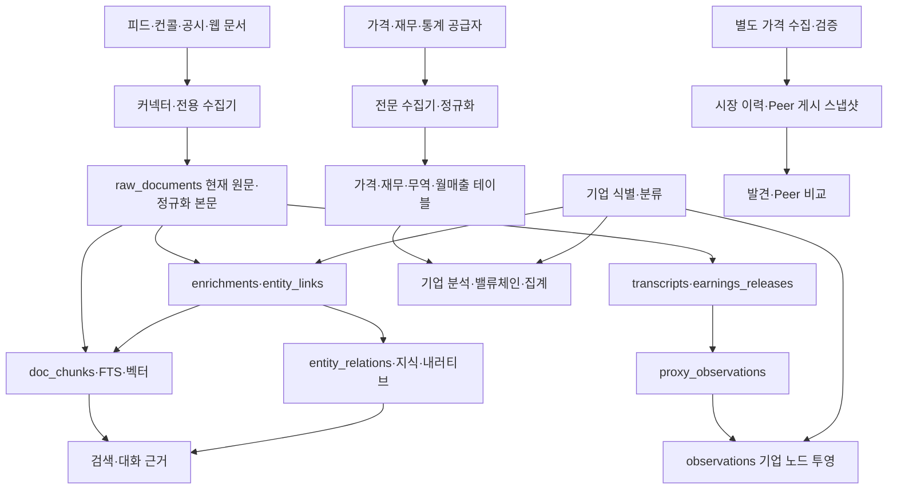

# 데이터 생명주기 — 원천 보존·정제 연결·활용 계약

> 상태: **현행 구조 대조 완료 / 개선 계약 정의 / 런타임 적용 전** (2026-11-03).
> 범위: 도메인을 가로지르는 데이터 소유권, 식별자, 시간, 파생 갱신, 재현성.
> 이 문서의 목표 필드·상태·검증 기준은 신규 DB 컬럼이나 API가 이미 구현됐다는 뜻이 아니다.
> [SYSTEM](../SYSTEM.md) · [스펙 목록](README.md). 초기 척추 도입 기록은 [phase1-etl-spine](phase1-etl-spine.md).

## 1. 계층과 책임

| 계층 | 책임 | 경계 |
|---|---|---|
| L1 원천 보존 | 무엇을 어디서 언제 받았는지 보존 | 공급자 수치도 외부 관측이지 절대적 사실은 아님. 원문·응답과 정규화 값을 구별 |
| L2 정제·연결 | 단위·기간·기업 식별, 요약, 주장·관측 추출, 근거 연결 | 출처의 주장과 모델의 추론, 사용자 판단을 섞지 않음 |
| L3 활용 | 검색 인덱스, 그래프 탐색, 비교·집계, 신호·보고서 | 입력으로 돌아갈 수 있어야 하며 원본의 진실성을 대신 판정하지 않음 |

이것은 **논리적 책임 구분**이다. DB를 세 개로 분할하거나 모든 데이터를 `raw_documents`로 이전하라는 규칙이 아니다. 현재 한 테이블 안에 원천 필드와 정제 필드가 공존할 수 있다.

사용자 주석·메모·판단·대화는 별도 원본이다. L3 화면에서 작성됐어도 재생성 가능한 캐시로 취급하지 않는다. 모델 생성물도 당시 판단의 근거로 보존된 결과라면 버전 기록이며, 재실행으로 동일 문장이 나온다고 가정하지 않는다.

### 현행 흐름

화살표는 실제 의존 방향이다. 모든 변경이 자동 전파된다는 뜻은 아니다. 현재 전파 공백은 §5에 명시한다.

## 2. 기준 저장소와 변경 책임

기본 위치는 `backend/db/stock_explorer.db`. 표의 “기준”은 해당 도메인에서 현재 읽는 기준이며, 모든 공급자 응답을 불변 보관한다는 뜻이 아니다. 코드 경로는 저장소 루트 기준이다.

| 데이터 | 현재 기준·키 | 적재/갱신 책임 | 보존·파생 경계 |
|---|---|---|---|
| 피드·웹·문서 | `raw_documents`의 `(source_type, source_id)` | `pipeline/store.py:store_document`, 전용 문서 수집기 | 본문 hash가 바뀌면 같은 행 UPDATE. raw_content와 markdown은 역할이 다름. 모든 과거 원문 버전은 없음 |
| 요약·문서 엔티티 | `enrichments.doc_id`, `entity_links` | `store.py:apply_enrichment` | 요약·링크를 교체. 모델/내용 hash 일부 보존; 처리 규칙 전체 버전은 없음 |
| 국내 회사·공시·재무 | `companies.corp_code/stock_code`, `disclosures.rcp_no`, `financial_statements` | DART 서비스·국내 수집 작업 | 수집·정규화된 현재 레코드. CFS/OFS·보고 코드·계정 구분을 유지. 전체 원응답 이력 저장소로 해석하지 않음 |
| 국내·미국 가격 | `stock_prices`, `us_prices`: 코드+거래일 | 가격 서비스, `pipeline/us_data.py` | 공급자/조정 기준에 따라 값이 달라짐. US 수집은 `auto_adjust=False`. 재수집 덮어쓰기 경로 존재 |
| 발견용 이력 | `backend/db/market_history.sqlite`의 `prices/coverage/metadata` | `scripts/refresh_market_history.py` | 별도 검증·게시 데이터셋. 운영 가격 DB와 교환 가능한 동일 가격으로 간주하지 않음 |
| Peer | 카탈로그 및 `logs/peer-monitor/current.json`과 불변 게시 스냅샷 | `scripts/refresh_peer_monitor.py`, `scripts/research/peer_monitor.py` | 가격·카탈로그·정책 버전이 함께 게시됨. 조회는 수집하지 않음. [Peer 계약](peer-intelligence.md) 소유 |
| 컨콜·실적 발표 | `transcripts`의 ticker+fiscal_year+fiscal_period, `raw_doc_id`; `earnings_releases.doc_id` | `pipeline/transcript.py`, 실적 발표 수집기 | 콜 본문과 메타데이터 분리. 콜 날짜는 보정 가능. `digest`, `call_extracts`, `call_momentum`은 파생 |
| 기업 노드·식별 | `entities.id`, 국내 aliases, `transcript_follow.entity_id` | 시딩·연결·명시적 병합 경로 | 현재 aliases는 완전한 issuer/listing 식별자 원장이 아님. NULL 연결과 법인 동일성 미확인을 구분 |
| 수출입 | `trade_stats`의 HS+period | `pipeline/trade.py` | 기간별 upsert. `trade_beneficiaries`는 기업 수혜 해석 캐시, 실제 공급 관계 증거 아님 |
| 해외 수치·기대 | `tw_monthly_revenue` 코드+월, `us_quarterly` ticker+q+metric, `ext_series`, `expectation_claims` | `tw_revenue.py`, `us_fundamentals.py`, 외부 지표·기대 추출기 | 월/분기 수치는 갱신 가능. 목표기간과 관측시점 구별. `us_fundamentals` JSON은 최신 캐시 |
| 기업 리서치 | `company_profiles`의 stock_code+version, 연결된 web 원문 | `pipeline/company_profile.py` | 보고서는 버전 보존. 출처 발췌와 원문 revision 보존은 별개 |
| 그래프·관측 | `entity_relations`, `proxy_observations`, `observations`, `knowledge*` | 인과 추출·지식 검토·`transcript.py:project_numeric_observations` | 문서 주장·추론·검토 결과를 구분. `observations`는 선택적 투영이며 모든 수치의 통합 원본이 아님 |
| 밸류체인 | `pipeline/value_chain.py`의 단계 지도와 각 도메인 수치 | 밸류체인 모듈 | 기업 묶음의 단계 관계를 기업 간 SUPPLIES 사실로 자동 변환하지 않음 |
| 검색 | `doc_chunks`, FTS·벡터·문서 centroid | `pipeline/chunks.py`, `pipeline/search.py` | 재생성 가능한 인덱스. 근거는 문서로 회수. 본문·메타데이터·모델 변경에 대한 갱신 범위가 다름 |
| 사용자 기록 | 스터디·주석·대화·판단, `vault/`, 발견 별도 저장소 | 각 기능 저장 API | 자동 재생성/덮어쓰기 대상에서 제외. [스터디](study-mode.md)·[발견](market-codeact.md)의 원본 보호 계약 유지 |

### 저장물의 보존 등급

- **원천 증거:** 수집 본문·첨부·응답. 삭제·덮어쓰기로 잃으면 외부에서 복구하지 못할 수 있음.
- **정제 현재값:** 공급자 수치를 정규화한 현재 레코드. 원천 이력이 없으면 과거 정제값을 복원할 수 없음.
- **게시·판단 스냅샷:** 당시 보고서·신호·사용 근거. 새 버전을 만들어도 이전 판단 기록은 보존.
- **재생성 가능한 투영:** 청크·벡터·집계 캐시. 입력과 처리 버전이 있어야 의미 있는 재생성이 가능.
- **사용자 원본:** 메모·주석·판단. 모델 재실행이나 수집 수정으로 변경 금지.

각 저장소의 백업 대상·복구 검증은 별도다. 메인 DB 백업만으로 `media/`, `vault/`, Peer 게시본, 발견 저장소가 함께 보존됐다고 간주하지 않는다.

## 3. 공통 식별·출처 계약 — 개선 기준

아래는 구현 목표의 논리 필드다. 실제 테이블 설계·API 필드 추가는 해당 기능 변경에서 명시한다.

### 원천 레코드

`source_namespace + source_record_key + revision_id`로 수집본을 구별한다. 동일 본문이라도 제목·URL·공개일이 달라질 수 있어 본문 hash만으로 revision 전체를 대표하지 않는다.

필수 의미: 공급자, 원천 키/URL, 수집 시각, 원문 payload 또는 보존 위치, 본문/메타데이터 hash, 파서 버전, 수집 실행 ID. 알려지지 않은 값은 unknown이며 추정치를 실제값으로 채우지 않는다. 동일 revision 재수집은 중복 증거를 만들지 않는다.

현행 데이터에 revision을 추가할 때 **처음 남아 있는 현재본**을 기준점으로 삼는다. 이미 덮어쓴 옛 원문을 복원한 것처럼 기록하지 않는다. 최초 인지 시각이 불명확하면 backfill 시각과 별개로 unknown을 유지한다.

### 기업 식별

- 법인/사업체(issuer)와 상장 증권(listing)을 구별한다. 가격은 listing, 재무·사업 관계는 해당 보고 주체에 귀속한다.
- DART corp_code, SEC CIK, 시장·거래소·ticker와 유효기간을 식별자별로 관리한다. CIK는 보고 주체를 식별하며 상장 증권 하나를 대신하지 않는다.
- 이름·번역·약칭은 후보 검색용이다. 이름 유사성만으로 구 법인, ADR, 우선주, 복수 상장을 병합하지 않는다.
- `resolved / unresolved / ambiguous`의 의미를 유지한다. 미연결도 유효한 상태이며 숫자 0이나 임의 기업으로 대체하지 않는다.
- 식별 수정은 원문 변경이 아니다. 문서 링크·관측 귀속·그룹 구성 투영만 검토하고 사용자 기록의 과거 판단은 다시 쓰지 않는다.

### 주장·관계·관측

출처 revision과 인용 위치/발췌, 추출기·모델·프롬프트 버전, 대상·단위·기간, epistemic 상태를 연결한다. `source_status=verified`는 인과가 증명됐다는 뜻이 아니다.

관계 자체의 정체성과 각 출처 증거의 정체성을 분리한다. 서로 다른 문서의 같은 주장은 여러 근거로 남길 수 있으나, 동일 문서 revision의 재추출이 새 독립 근거를 만들면 안 된다. nullable 유효기간에 의존한 UNIQUE만으로 멱등성을 보장하지 않는다.

수치 투영은 원본 관측 ID로 역추적 가능해야 한다. 여러 출처가 동일 기업·지표·날짜에 다른 값을 주면 충돌을 남기고 선택 정책을 명시한다. 날짜/값 기반 키만으로 한 값을 조용히 버리지 않는다.

## 4. 시간 계약 — 개선 기준

| 의미 | 용도 | 금지하는 대체 |
|---|---|---|
| `event_at` | 실제 사건·발표·콜 발생 시점 | 회계분기 말이나 추정일을 확정 사건일로 저장 |
| `period_start/end`, fiscal label | 수치가 설명하는 기간·회계연도 | 달력연도와 회사 회계연도를 동일시 |
| `published_at` | 원천 공개 시각 | 수집 시각을 실제 공개 시각으로 표시 |
| `first_seen_at` / `fetched_at` | 최초 관측 / 해당 수집 시각 | 현재 fetch 시각으로 최초 관측 이력 덮기 |
| `known_at` | 이 버전이 시스템에서 사용 가능해진 시각 | 사건일만 보고 나중에 수집한 데이터를 과거 신호에 사용 |
| `valid_from/to` | 관계·식별자·분류의 유효기간 | 생성 시각을 사업 관계 성립일로 간주 |
| `built_at` | 파생 결과 생성 시각 | 입력 최신성의 증거로 사용 |

날짜만 아는 원천에는 precision·timezone·basis(원천 명시/추정/보정)도 필요하다. 실제 컨콜 시각과 SEC 공시일은 다를 수 있으므로 보정 근거를 남긴다. 미래 목표기간을 가진 가이던스는 정상이고, 미래 관측 시각과 구별한다.

현재 일부 컨콜의 published_at은 수집 시각에서 보정된 값이며, 각 도메인은 이 계약의 일부만 구현한다. 전체 시스템의 point-in-time 조회·백테스트 재현성은 아직 보장하지 않는다.

## 5. 파생 의존성과 변경 전파

| 변경 | 영향받는 결과 | 현재 동작/공백 | 개선 완료 조건 |
|---|---|---|---|
| 원문 본문 변경 | 정규화·요약·링크·청크·문서 기반 주장 | store가 원문 UPDATE, 요약/링크 교체. 청크는 본문 hash로 재생성. 주장 전체에 공통 revision 참조 없음 | 입력 revision을 변경하고 영향 투영을 stale 처리. 과거 인용은 당시 revision을 유지 |
| 제목·게시일 변경 | 검색 접두어·해당 임베딩 입력·날짜 필터 | 동일 본문 store 경로는 메타데이터 갱신을 보장하지 않음. 청크 선별은 본문 hash만 사용 | metadata fingerprint 별도 비교. 본문 분할은 유지 가능하되 실제 입력이 바뀐 인덱스 갱신 |
| 요약만 변경 | FTS 접두어·문맥, 요약 소비 결과 | 접두어는 요약을 포함하지만 갱신 기준에는 없음 | 접두어 갱신. 현행 청크 임베딩 입력은 요약 제외이므로 요약만으로 재임베딩하지 않음 |
| 콜 날짜 보정 | proxy 관측일·observations 투영·날짜 기반 소비 | 보정 함수는 transcripts/raw_documents 수정, proxy 관측은 종전 날짜 잔존 가능 | 원본 관측 lineage 기준 동기화. 옛 투영의 잔존/중복 없음. 콜 기반 후속 소비도 영향 목록 검토 |
| 기업 연결 변경 | 문서 기업 링크·관측 귀속·기업 단위 집계 | 경로별 이름·alias·entity_id 사용 | 변경 전후 연결 검토와 영향 목록. 모호한 법인은 검토 상태 유지 |
| 분류·관계 재추출 | MEMBER_OF·근거·그룹/노출 집계 | nullable valid_from UNIQUE로 동일 출처 중복 가능 | 같은 입력 두 번 실행해 관계/근거 수 동일. 독립 출처 증거는 보존 |
| 가격·재무·통계 정정 | 지표·차트·비교·신호 | 도메인별 upsert/캐시/게시 정책이 다름 | dataset version별 재계산. 기존 게시본·과거 신호는 보존, 수정 결과는 새 버전 |
| 파서·추출기·모델 변경 | 해당 처리의 출력과 하위 소비 | model 일부 기록, 공통 처리 버전 없음 | 입력 같아도 처리 버전이 다르면 재처리 후보. LLM 결과의 바이트 동일성은 요구하지 않음 |

### 재생성과 게시 규칙

1. 입력 버전 집합을 고정하고 계산한다. 긴 LLM 호출 중 DB 쓰기 잠금을 잡지 않는 기존 방식을 유지한다.
2. 계산 완료 전에 입력이 바뀌었으면 최신 결과로 게시하지 않는다. 재시도 또는 이전 입력용 결과로 남긴다.
3. 입력 fingerprint, 처리 버전, 생성 시각, 품질 상태를 결과와 함께 기록한다.
4. 검증된 결과를 원자적으로 게시한다. 실패 시 마지막 정상 결과와 실패/오래됨 상태를 함께 제공한다.
5. 원본 revision과 당시 신호/판단의 연결은 재계산으로 바꾸지 않는다.

공통 스케줄러나 메시지 큐 신설이 전제는 아니다. 기존 배치에 변경 감지와 입력 버전 검사를 적용하는 것부터 시작한다. 현재 모든 기능이 위 규칙을 만족하는 것은 아니다.

## 6. 활용 계층의 소비 계약

| 소비 기능 | 필요한 입력·조건 | 결측/불일치 처리 |
|---|---|---|
| 피드·검색 | 원문 revision, 요약·접두어 최신성, 문서 시점 | raw 존재/요약 대기/검색 대기 구분. 오래된 문맥으로 최신 요약인 척하지 않음 |
| 기업·지식그래프 | 식별자, 관계별 근거·epistemic 상태, 유효기간 | 미연결·추론·출처 미검증을 표시. 동시언급을 공급 관계로 승격하지 않음 |
| 업종→사업군→Peer | listing, 멤버십/가격/정책 snapshot, 거래일·조정 기준 | 기업행사·가격 불연속·커버리지 부족이면 미평가. 기존 자동 신호 held 조건 유지 |
| 밸류체인 | 단계 지도 버전, 각 지표의 관측 기간·단위·원천, 기업 연결 근거 | HS·단계 묶음의 움직임을 개별 기업 실적으로 등치하지 않음 |
| 보고서·신호 | 당시 입력 버전·사용 근거·알려진 시점·판정 버전 | 과거 기준일에 없는 자료 사용 금지. 현재 정정치 재평가는 별도 결과로 표시 |
| 스터디·사용자 판단 | 고정 본문·주석·작성 당시 근거 | 수집·모델 변경으로 사용자 작성 기록 재작성 금지 |

품질 상태는 의미상 `ready / partial / stale / blocked / unavailable`을 구분한다. 이는 새 API enum 도입 선언이 아니다. 기능별 기존 응답과 매핑하고 실제 변경 시 API 계약 절차를 따른다.

작업 실행의 `ok / partial / error / skipped / disabled`와 데이터 품질 상태는 별개다. 성공적으로 “원천 새 기간 없음”을 확인한 skipped는 결함이 아니다. 관리자 off를 수집 실패나 최신 처리 완료로 표시하지 않는다.

## 7. 개선 작업 단위와 검증 계약 — 미구현

### A. 콜 날짜·수치 투영 정합성

- 소유 모듈: `transcript.py`의 날짜 보정·관측 투영, 관련 schema와 소비 경로.
- 먼저 원본 proxy ID → 현재 투영 후보의 대응을 dry-run으로 산출한다. 여러 원본이 같은 투영 키에 충돌하면 자동 삭제/교체하지 않고 충돌로 분리한다.
- 원본 ID lineage 또는 이에 준하는 명시적 매핑을 확보한 뒤 날짜·투영을 함께 정정한다. 미래 전망 목표기간은 변경하지 않는다.
- 검증: IREN/MSFT처럼 보정 전후가 다른 fixture; 보정 후 일치; 재실행 멱등; 과거 날짜 행 잔존 없음; 같은 날 복수 출처 충돌; 수동·다른 source 관측 보존.

### B. 검색 메타데이터 갱신

- 소유 모듈: `chunks.py`, `store.py`, 검색 입력 생성 함수.
- 본문 분할 hash / 접두어 hash / 임베딩 입력+모델 버전을 구별한다. 메타데이터 변경을 누락하는 저장 경로도 검증한다.
- 검증: 본문 불변+요약 변경 → 접두어/FTS만 갱신; 날짜/제목 변경 → 해당 임베딩 입력 갱신; 본문 변경 → 재청킹; 실패 시 불완전 게시 방지; 두 번째 실행 변화 0.

### C. 분류 관계 멱등성

- 소유 모듈: `store.py:_link`, relation schema, 다른 MEMBER_OF 작성자.
- 관계 ID와 출처 증거를 분리할지 기존 스키마에서 근거별 키를 둘지 모든 작성자를 조사한 후 결정한다. 현재 관계를 지우고 새로 만드는 일괄 변경은 피한다.
- 검증: 동일 source revision 재처리 중복 0; 다른 source 근거 유지; 문서 미지정·날짜 NULL 처리; 변경된 분류의 이전 근거 철회/대체; 관련 참조 보존.

### D. 기업 식별·이력 확대

- 활성 모니터링의 unresolved 후보부터 검토. 이름 유사도 자동 병합은 하지 않는다.
- 원천 revision·처리 버전·입력 lineage를 신규 수집부터 점진 도입한다. 기존 행은 제한을 표시한 기준점으로 이관한다.
- 검증: 동일 ticker의 시장/시기 차이, ADR/보통주, 법인 재편, 별칭 충돌. 과거 신호 한 건에서 원천→처리→결과 역추적.

### 실행 전후 공통 절차

읽기 전용 baseline → 실패 fixture → 최소 코드 수정 → 회귀 검증 → 운영 백업/복구 검증 → dry-run 영향 목록 → 충돌 격리 → 대상에 한정한 반영 → 같은 점검 재실행 순서다. 백엔드 변경 후 재시작과 live API 계약 검증은 별도 필수다. **본 문서 작성으로 운영 정정이나 새 schema 배포가 완료된 것은 아니다.**

## 8. 문서 유지

새 수집기를 추가할 때 §2에 기준 저장소·키·보존 방식을 등록한다. 파생 처리를 추가할 때 §5의 입력·갱신 조건과 §6의 품질 조건을 명시한다. 구현 상태가 바뀌면 해당 기능 spec 및 SYSTEM과 같이 갱신한다.

개인 운영 수량·원문·점검 로그는 공개 spec에 복사하지 않는다. 이 문서는 지속적인 계약이고 실행별 진단 산출물은 로컬 점검 디렉터리에 둔다.
